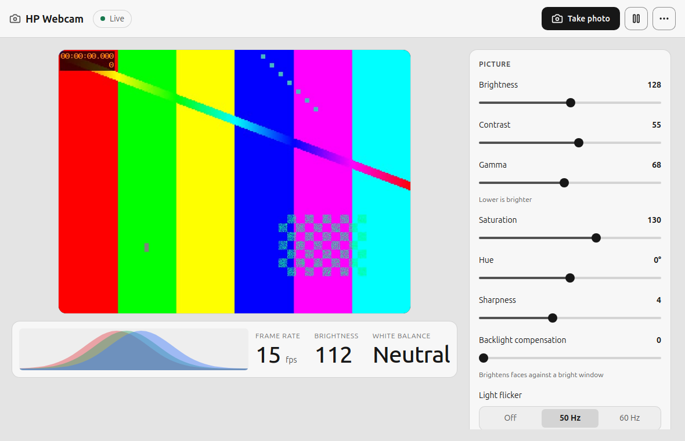
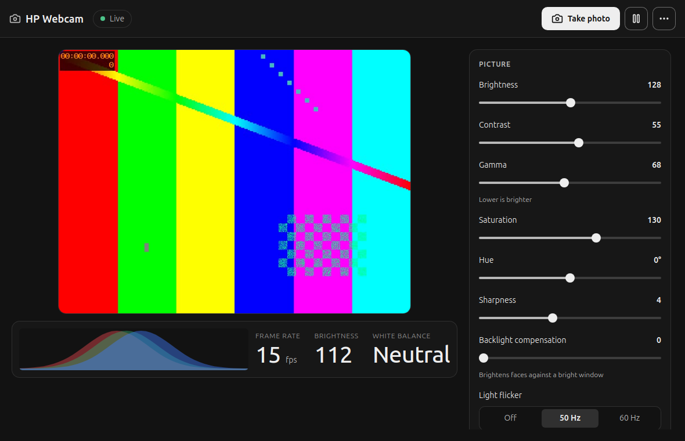

# HP Webcam tuner

Linux picture tuning for the **HP USB Webcam (AU165AA, USB `03f0:8007`)**, a VGA camera built on a
Vimicro UVC bridge. The camera has no white balance of its own and hides most of its image pipeline
behind an undocumented vendor extension unit. This project decodes that interface and gives you a
desktop app, a command line tool and an optional virtual camera.




*(Screenshots use a generated test pattern instead of the camera.)*

## What you get

- **App** (`hpcam_app.py`): live preview with an RGB histogram and readouts, all picture controls,
  the camera's hidden red/green/blue gains with automatic white balance or one-shot balancing,
  photos (the camera's snapshot button works too), a virtual camera for video-call apps with noise
  reduction and sharpening, and a switch to keep settings applied after replugging.
  Dark and light themes follow the system.
- **CLI** (`hpcam.py`): `status`, `calibrate` (one-shot white balance), `apply`, `run` (keep the
  profile applied), `virtual`, `reset`.
- Settings live in `~/.config/hpcam/profile.json`.

## Install

**Debian, Ubuntu, Linux Mint:** download `hp-webcam-tuner_<version>_all.deb` from
[Releases](https://github.com/skinnie/hp-webcam-tuner/releases) and install it:

```sh
sudo apt install ./hp-webcam-tuner_0.1.1_all.deb
```

That pulls in the dependencies, adds "HP Webcam" to the applications menu, installs the `hpcam`
command, and sets up the virtual camera (`/dev/video10`, via the recommended `v4l2loopback-dkms`).
Remove it with `sudo apt remove hp-webcam-tuner`.

**From source:** needs Python 3 with NumPy, ffmpeg, and for the app window WebKitGTK 4.1 bindings
(`gir1.2-webkit2-4.1` on Debian/Ubuntu/Mint). No root needed.

```sh
sh install/install.sh            # adds "HP Webcam" to the applications menu
sh install/install.sh --service  # also keeps settings applied after replugging
python3 hpcam_app.py --browser   # or open the UI in a browser instead of the app window
```

Optional, needs root once: a virtual camera (`/dev/video10`, "HP Webcam (tuned)") loaded at boot,
so video-call apps can use the processed picture (turn on "Send to other apps" in the app):

```sh
sudo sh install/setup-root.sh        # sudo sh install/setup-root.sh --undo to remove
```

## How it works

The camera exposes a vendor extension unit (unit 4, GUID `d13577f0-8d89-4700-812e-7dd5e2fdb898`).
The protocol was recovered from HP's Windows "Button Manager" (`BM.exe`) on the original disc and
confirmed on the device:

| Selector | Role |
|---|---|
| 5 | SET `[addr, len(1-4), 0, 0]` selects a register; GET returns status (byte 3 = 1 while the snapshot button is pressed) |
| 1, 2, 3, 7 | four separate 256-byte register spaces, read at the selected address |
| 3 (write) | SET `[addr, value, 1, keep]` after selecting the address |

Mapped registers:

| Space:reg | Meaning |
|---|---|
| 3:04 / 3:05 / 3:06 | **green / red / blue** gain, 0x40 = 1.0 (the camera has no automatic white balance) |
| 3:07-09 | colour offsets (brightness control) |
| 3:5B-73, 3:5F | 5x5 luma grid and mean luma (auto exposure statistics) |
| 3:E1 | GPIO, bit 4 = LED |
| 1:17-28 | 3x3 colour matrix (saturation, hue) |
| 1:A2-AB | tone curve (contrast, gamma) |
| 1:B6 | sharpening strength |
| 1:13 | digital brightness multiplier after the sensor |
| 7:xx | firmware power-on defaults (gamma, WB 5000K, AE limits, 640 width); read-only, no sensor id |
| 1:56-57, 1:58 | exposure and gain, driven by the firmware's auto exposure (writes are walked back within ~2 s) |

All writes are volatile: unplugging restores factory values, and the app and service re-apply your
profile once streaming starts. Space 7 looks like a settings table and selectors 6 and 8 are unknown;
this project never writes them. Full notes, including what was tried for exposure control and
why it is not exposed, are in [NOTES.md](NOTES.md).

## Known limits

- The sensor is 640x480. Detail is limited by the fixed-focus lens.
- Uncompressed (YUYV) 640x480 does not work: without the `uvcvideo` bandwidth quirk it fails with
  "No space left on device", with it the stream starts but delivers no frames. MJPEG is used.
- The camera does 30 fps in bright light (measured 29-31 fps pointed at a lamp), but in ordinary
  room light its firmware switches to a slow low-light mode of about 4-6 fps. Linux negotiates
  30 fps correctly; the firmware decides, so Windows behaves the same. No register found controls
  the switch; a lamp or screen light on your face is the fix.
- The light-flicker setting should match your mains (50 Hz in Europe). 60 Hz or Off is slightly
  faster in dim light but can show rolling bands under lamps.

## Development

- `tools/`: protocol and register tools (`vmxu.py`, `dump.py`, `mapctl.py`, `aescan.py`, ...),
  `uitest.py` (interaction tests against the running app, off-screen WebKit), `check_contrast.py`
  (token contrast, both themes), `make_harness.py` + `run_ux_gates.sh` (static `ui/harness.html` for
  the [ux-ui-agent-skills](https://github.com/plugin87/ux-ui-agent-skills) gates; 22/22 pass).
- `install/build_deb.sh VERSION` builds the .deb into `dist/` (no root needed).
- UI components adapted from [Uiverse.io](https://uiverse.io) (Galaxy); see [ui/CREDITS.md](ui/CREDITS.md).

## License

MIT, see [LICENSE](LICENSE). Not affiliated with HP or Vimicro.
